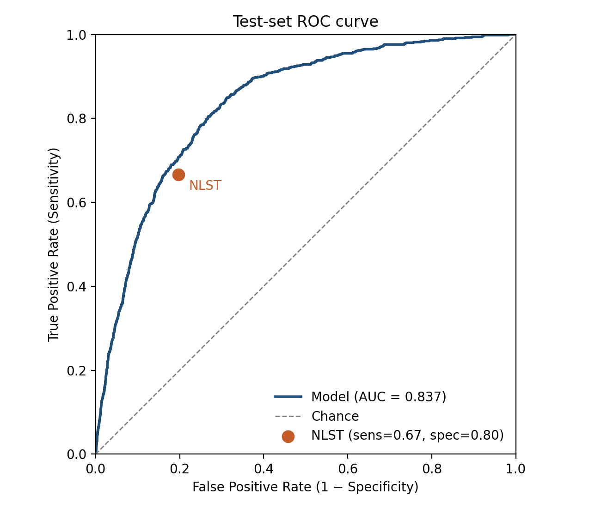
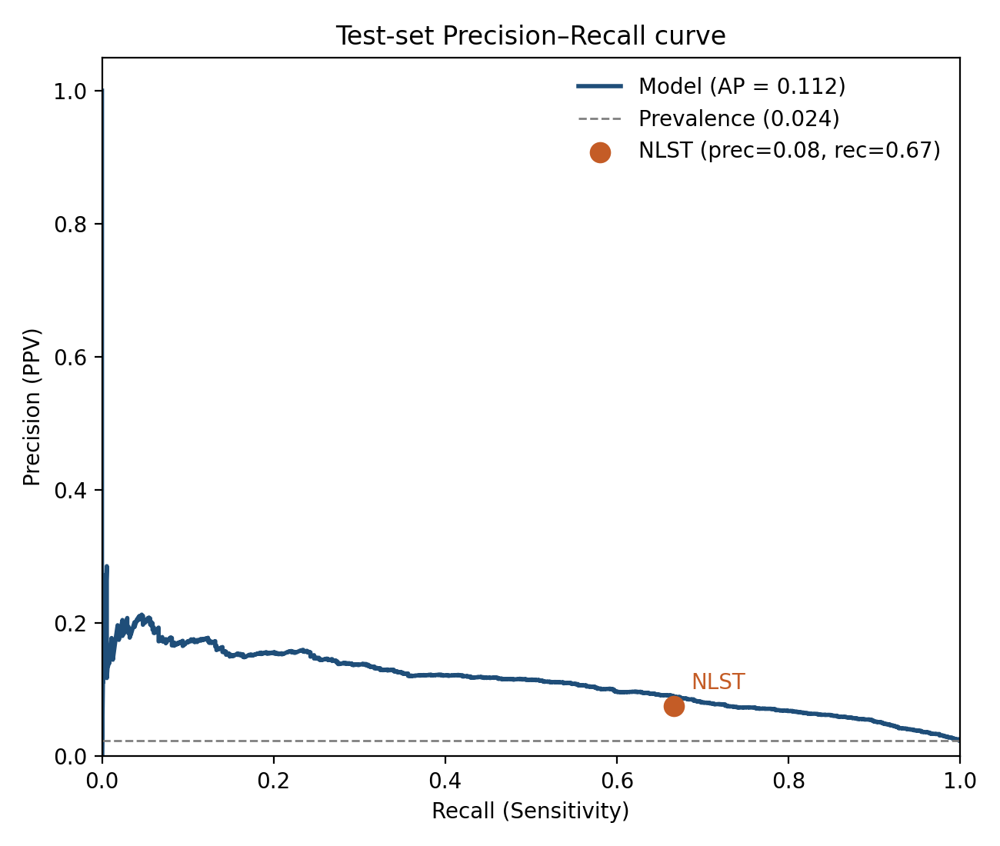
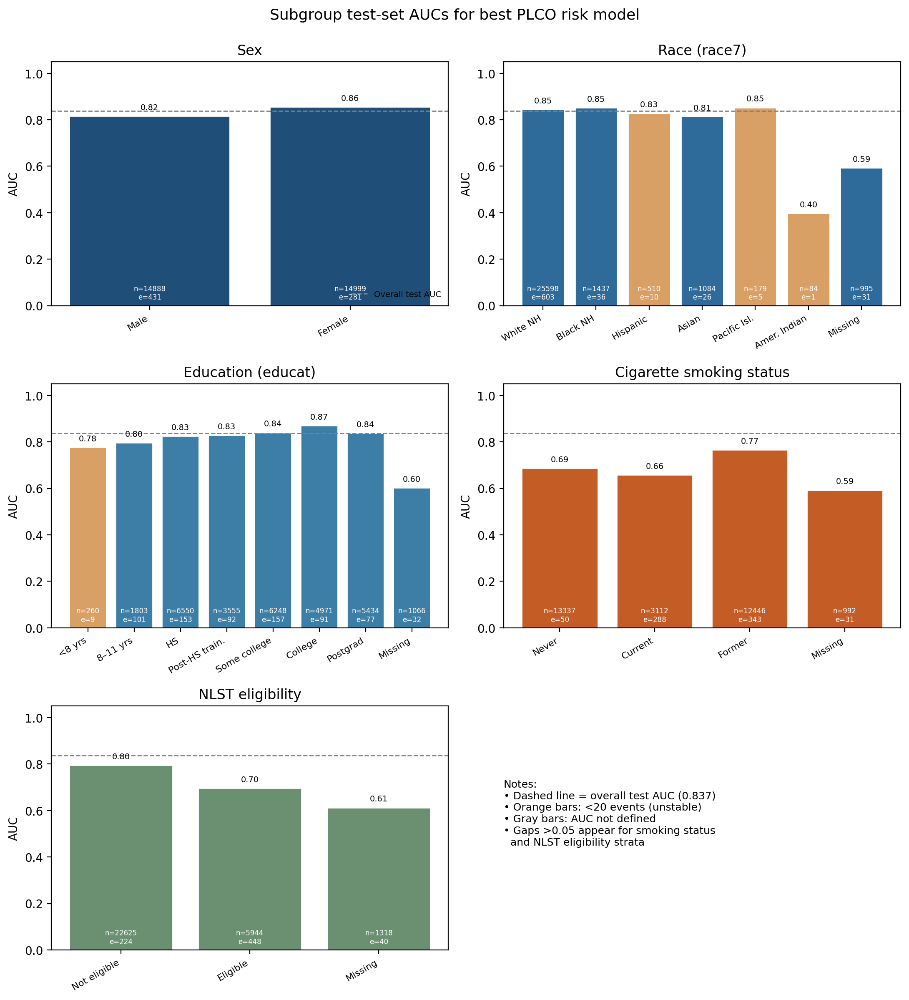
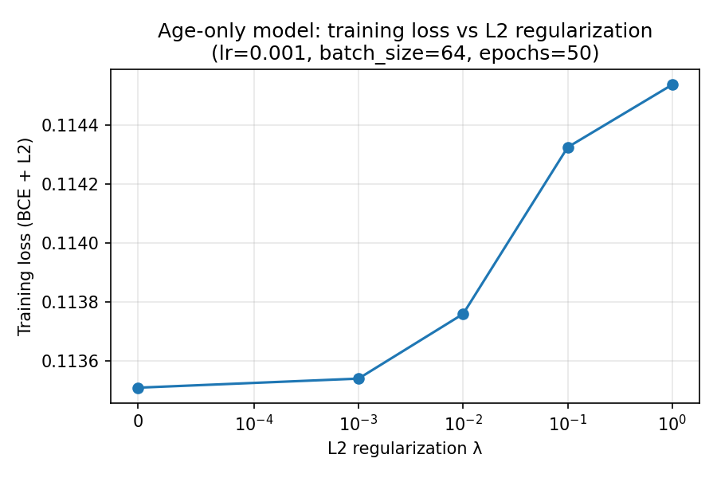

# Lung Cancer Screening with Machine Learning

A lung cancer risk model trained on questionnaire data from the PLCO cancer screening trial. It is compared against the eligibility criteria used in the NLST screening trial and audited for performance across patient subgroups. Built as coursework for CPH 100A.

## Why it matters

Low-dose CT screening cuts lung cancer mortality by 20–24% (NLST and NELSON trials), but a screening program only works if it reaches the right people. Screening too few people misses early cancers, while screening too many causes harm from false positives and unnecessary follow-up. Today's guidelines use simple age and smoking cutoffs. This project tests whether a learned risk model can choose who to screen more accurately.

## Results

| Model | Validation AUC | Test AUC |
|---|---|---|
| Age only | 0.607 | — |
| Full model (13 features) | **0.849** | **0.837** |

**The model beats the NLST criteria.** At the NLST guideline's operating point (sensitivity 0.67, specificity 0.80), the model's ROC curve lies above it. At the same specificity, the model would catch more cancers than the current eligibility rules.

<p align="center">
  
  
</p>

Lung cancer is rare in this cohort (2.4% prevalence). The model's average precision of 0.112 is about 4.7× the base rate.

## Subgroup audit

I computed test AUC for each subgroup by sex, race, education, smoking status and NLST eligibility, to check where the model is weaker. Full numbers are in [`subgroup_auc_summary.csv`](subgroup_auc_summary.csv).



Takeaways:
- **Consistent across sex and most racial groups:** AUC ranges from 0.81 to 0.86 for male, female, White, Black, Hispanic, Asian, and Pacific Islander participants.
- **Weaker where the data is thin:** American Indian participants (n = 84, only 1 cancer case) and rows with missing demographics have much lower AUC. Those estimates are unreliable, and these groups need more data before anyone could trust the model for them.
- **Harder within NLST-eligible patients:** AUC is 0.70 among NLST-eligible people vs. 0.80 among ineligible people. Once everyone is an older heavy smoker, telling apart who gets cancer is a harder problem.

## What I built

- **Logistic regression from scratch** (`logistic_regression.py`): mini-batch SGD with L2 regularization in NumPy. It uses a numerically stable sigmoid, and the gradient is `p − y`, so training never differentiates through `log(p)`.
- **Feature pipeline** (`vectorizer.py`):
  - Numerical features (age, pack-years, years smoked, years since quitting, BMI) are standardized, with mean imputation and a missingness indicator.
  - Education is integer-encoded as an ordinal feature.
  - Categorical features (sex, race, smoking status, family history, emphysema, bronchitis, cigarettes per day) are one-hot encoded, with "missing" as its own category.
  - Optional quantile histogram binning is also available.
- **Parallel grid search** (`dispatcher.py`): expands `grid_search.json` into every hyperparameter combination, runs them across worker processes, and writes a summary to `grid_results.csv`.



## Running it

```bash
pip install -r requirements.txt
python main.py --plco_data_path /path/to/lung_prsn.csv --learning_rate 1e-3 --batch_size 64 --num_epochs 50
python dispatcher.py --config_path grid_search.json --plco_data_path /path/to/lung_prsn.csv --num_workers 4
```

The PLCO data is available on request from the NCI's [Cancer Data Access System](https://cdas.cancer.gov/plco/). It is not included in this repo.

## Limitations

- PLCO participants were trial volunteers, who tend to be healthier and less diverse than the general screening population, so the results may not carry over.
- This is a single train/validation/test split on one cohort. Before a model like this could inform guidelines, it would need external validation (for example on NLST or UK Biobank data), calibration checks, and a cost-effectiveness analysis.
